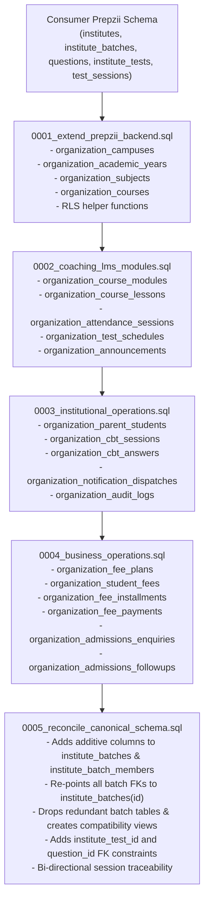

# Prepzii B2B LMS — Canonical Schema Reconciliation & Staging Readiness Report

## Executive Summary

This document establishes the canonical data model, migration reconciliation plan, and safety verification protocol for connecting the Prepzii B2B Learning Management System to the existing consumer Prepzii Supabase backend.

---

## 1. Canonical Data Model

### A. Pre-Existing Consumer Prepzii Tables (Single Source of Truth)

| Table | Primary Key | Key Foreign Keys | Columns |
| :--- | :--- | :--- | :--- |
| `public.institutes` | `id uuid` | None (Root Tenant) | `name`, `slug` (UNIQUE), `logo_url`, `owner_user_id`, `status`, `created_at` |
| `public.institute_members` | `id uuid` | `institute_id -> institutes(id)` | `user_id` (Clerk `sub`), `email`, `role`, `status`, `created_at`, UNIQUE(`institute_id`, `user_id`) |
| `public.institute_batches` | `id uuid` | `institute_id -> institutes(id)` | `name`, `exam`, `target_year`, `created_at` *(Extended additively in B2B)* |
| `public.institute_batch_members` | `id uuid` | `batch_id -> institute_batches(id)`<br>`member_id -> institute_members(id)` | `created_at`, UNIQUE(`batch_id`, `member_id`) *(Extended additively in B2B)* |
| `public.questions` | `id uuid` | None | `exam`, `subject`, `chapter`, `topic`, `difficulty`, `question_type`, `question_text`, `question_image`, `option_a..d`, `correct_option`, `marks`, `negative_marks`, `is_active`, `source_type`, `status` |
| `public.pyq_questions` | `id uuid` | None | `question_text`, `option_a..d`, `correct_option`, `correct_options`, `numerical_answer`, `numerical_min`, `numerical_max`, `marks_positive`, `marks_negative`, `exam`, `subject`, `chapter`, `year`, `status` |
| `public.institute_tests` | `id uuid` | `institute_id -> institutes(id)` | `title`, `status`, `created_at` |
| `public.institute_test_questions` | `id uuid` | `institute_id -> institutes(id)`<br>`institute_test_id -> institute_tests(id)`<br>`question_id -> questions(id)` | `question_order`, `created_at`, UNIQUE(`institute_test_id`, `question_id`) |
| `public.test_sessions` | `id uuid` | `test_id -> institute_tests(id)` | `user_id`, `status`, `started_at`, `completed_at`, `score`, `created_at` |
| `public.test_attempts` | `id uuid` | `test_id -> institute_tests(id)`<br>`session_id -> test_sessions(id)` | `user_id`, `score`, `created_at` |
| `public.institute_test_attempts` | `id uuid` | `institute_id -> institutes(id)`<br>`institute_test_id -> institute_tests(id)`<br>`session_id -> test_sessions(id)`<br>`attempt_id -> test_attempts(id)` | `user_id` (Clerk `sub`), `status`, `started_at`, `submitted_at`, `created_at` |

---

## 2. Revised Migration Dependency Report



### Dependency Order & Execution Plan

1. **`0001_extend_prepzii_backend.sql`**:
   - Creates root organizational structures (`organization_campuses`, `organization_academic_years`, `organization_subjects`, `organization_courses`).
   - Installs core RLS security functions: `requesting_user_id()`, `is_organization_member()`, `has_organization_role()`.
2. **`0002_coaching_lms_modules.sql`**:
   - Creates course delivery modules and lessons.
   - Sets up batch attendance sessions and records.
   - Sets up test scheduling and announcements.
3. **`0003_institutional_operations.sql`**:
   - Creates verified parent-student relationships (`organization_parent_students`).
   - Establishes scheduled CBT candidate sessions and real-time autosave answers (`organization_cbt_answers`).
   - Installs notification dispatches and immutable audit trails (`organization_audit_logs`).
4. **`0004_business_operations.sql`**:
   - Creates fee plans, student fee ledgers, installments, and receipts with paise precision.
   - Installs admissions enquiries CRM and counselor follow-up timeline.
5. **`0005_reconcile_canonical_schema.sql`**:
   - Extends canonical `public.institute_batches` additively with `campus_id`, `academic_year_id`, `grade_level`, `room_number`, and `is_active`.
   - Extends canonical `public.institute_batch_members` additively with `roll_number`, `role`, and `enrolled_at`.
   - Re-points all 6 dependent tables to `public.institute_batches(id)`.
   - Adds explicit foreign key from `organization_test_schedules.test_id` to `public.institute_tests(id)`.
   - Replaces redundant table definitions with non-destructive backward-compatible SQL views (`organization_batches`, `organization_batch_members`).

---

## 3. Redundant Table Resolution

| Legacy Table (0002) | Canonical Consumer Table | Resolution Strategy |
| :--- | :--- | :--- |
| `organization_batches` | `public.institute_batches` | **Reconciled**: Additive columns (`campus_id`, `academic_year_id`, `grade_level`, `room_number`, `is_active`) added directly to `public.institute_batches`. Redundant table replaced with a backward-compatible SQL VIEW. |
| `organization_batch_members` | `public.institute_batch_members` | **Reconciled**: Additive columns (`roll_number`, `role`, `enrolled_at`) added to `public.institute_batch_members`. Redundant table replaced with a backward-compatible SQL VIEW. |
| `organization_test_schedules` | None (Coaching Extension) | **Retained as Coaching Extension**: Coaching institutes need batch-level scheduled time windows (`starts_at`, `ends_at`, `is_strict_timing`). Reconciled foreign keys point to `institute_tests(id)` and `institute_batches(id)`. |
| `organization_cbt_sessions` | Extends `institute_test_attempts` | **Retained as Coaching Extension**: Stores authoritative server timer state, marked-for-review list, and visited questions. Traceability FKs added to `test_sessions(id)` and `institute_test_attempts(id)`. |
| `organization_cbt_answers` | None (Coaching Extension) | **Retained as Coaching Extension**: Stores candidate per-question responses, time-spent tracking, and server score awards. Foreign key points to canonical `public.questions(id)`. |

---

## 4. PYQ Selection Architecture Recommendation

### Problem Statement
`public.institute_test_questions` enforces a strict foreign key:
```sql
foreign key (question_id) references public.questions(id)
```
PYQs reside in a separate table, `public.pyq_questions`. Silently writing PYQs into `public.questions` during test scheduling risks pollutive side effects, race conditions, and uncontrolled consumer bank mutations.

### Comparison of Architectural Approaches

| Dimension | Option 1: Controlled Idempotent Synchronization (RECOMMENDED) | Option 2: Polymorphic FK / Dual-Source Reference |
| :--- | :--- | :--- |
| **Consumer DB Impact** | **ZERO schema changes**. Consumer Prepzii queries and joins continue working unmodified. | **BREAKS CONSUMER SCHEMA**. Requires altering `institute_test_questions` in consumer app. |
| **Referential Integrity** | **Standard Postgres Foreign Key**. No dangling pointers. | Requires conditional or composite checks. |
| **Auditability** | Every synchronized PYQ creates an immutable record in `organization_audit_logs`. | No distinct synchronization event. |
| **Performance** | High: Standard B-tree primary key lookups. | Lower: Union joins across multiple tables. |
| **Rollback Risk** | None: Read-only browsing until administrator explicitly synchronizes. | High: Schema migration failure affects both applications. |

**Final Recommendation**: **Option 1 (Controlled Idempotent Synchronization)**.
Teachers browse and filter both `public.questions` and `public.pyq_questions`. If an unsynchronized PYQ is selected for a test, test creation halts with explicit guidance. Administrators can invoke `QuestionBankRepository.syncPyqQuestionsToCanonicalBank()` to synchronize the questions into `public.questions` with `source_type = 'PYQ'` and full audit traceability.

---

## 5. Repository DAL Payload Verification

| Repository | Canonical Database Operation | Verified Schema Compliance |
| :--- | :--- | :--- |
| `BatchRepository` | `listBatches` | Queries `id, institute_id, name, exam, target_year, created_at` from `institute_batches`. (No `status`/`is_active`). |
| `BatchRepository` | `createBatch` | Inserts `institute_id, name, exam, target_year` into `institute_batches`. |
| `BatchRepository` | `enrollStudent` | Resolves student to `institute_members` and links `institute_batch_members(batch_id, member_id)`. |
| `AssessmentRepository` | `createAndScheduleAssessment` | Verifies question existence in `public.questions` (read-only). Inserts `institute_tests` and `institute_test_questions(institute_id, institute_test_id, question_id, question_order)`. |
| `AssessmentRepository` | `submitCbtSession` | Pure grading via `@prepzii/assessment-core`. Inserts `institute_test_attempts(institute_id, institute_test_id, user_id, status, started_at, submitted_at)`. |
| `QuestionBankRepository` | `queryQuestions` | Reads canonical columns from `questions` and `pyq_questions` without mutation. |
| `QuestionBankRepository` | `syncPyqQuestionsToCanonicalBank` | Idempotent, audited upsert into `public.questions` with `source_type = 'PYQ'`. |
| `AttendanceRepository` | `saveRegister` | Inserts `organization_attendance_sessions` with `batch_id` pointing to `institute_batches(id)`. |
| `FeeRepository` | `recordPayment` | Uses exact paise arithmetic with receipt collision prevention. |
| `ParentRepository` | `getLinkedChildren` | Enforces IDOR protection (`parent_user_id = requesting_user_id()`) and suppresses unreleased answer keys. |

---

## 6. Test Suite & Verification Results

1. **Automated Unit & Regression Tests**:
   - `npm run test`: **45 passing automated tests** across all workspaces.
   - Exact numerical range grading ($[numericalMin, numericalMax]$) verified.
   - Question format validation & unsupported format rejection verified.
   - Canonical column name regression checks passing.
2. **Disposable SQL Database Integration Tests**:
   - `npm run test:sql` (`scripts/test-sql-schema-integration.py`): **16 / 16 passing constraint tests**.
   - Verified foreign key rejection on non-existent `member_id`, `test_id`, and `batch_id`.
   - Verified check constraint `ends_at > starts_at`.
   - Verified check constraint `total_amount_paise >= 0` and installments (1–12).
   - Verified transaction rollback behavior upon constraint violation.
   - Verified cascade deletion (`ON DELETE CASCADE`) on tenant removal.
   - Verified backward compatibility view queryability.
3. **Type Safety & Build**:
   - `npm run typecheck`: **0 errors** across `@prepzii/contracts`, `@prepzii/assessment-core`, `@prepzii/ui`, `@prepzii-b2b/web`.
   - `npm run build`: **30 Next.js 16 (Turbopack) routes compiled successfully**.
4. **Staging Preflight Check**:
   - `npm run preflight`: Read-only connectivity and schema inspection tool verified.
